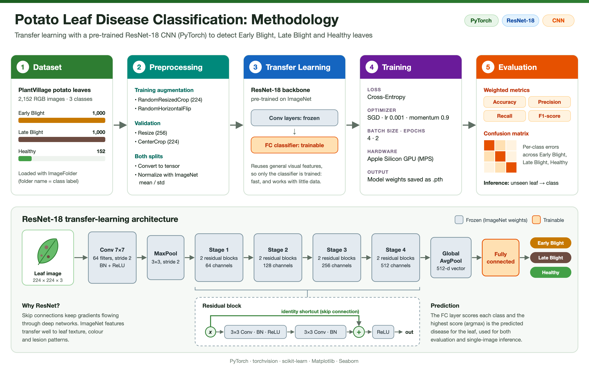

# 🥔 Potato Leaf Disease Classification with ResNet-18


A deep learning project that classifies potato leaf images as **Early Blight**, **Late Blight** or **Healthy**. It uses **transfer learning** with a pre-trained **ResNet-18** convolutional neural network, aimed at early detection of crop disease.

## 🧭 Methodology



<sub>Editable vector source: [`assets/methodology.svg`](assets/methodology.svg)</sub>

## 🔍 Overview

Early Blight (*Alternaria solani*) and Late Blight (*Phytophthora infestans*) cause major potato crop losses. This project fine-tunes an ImageNet-pre-trained ResNet-18 to recognise them from leaf photos. Its residual (skip) connections let deep networks train without vanishing gradients, and its pre-trained features transfer well to leaf textures and lesion patterns.

### Pipeline

| Stage | Details |
|---|---|
| **1. Dataset** | PlantVillage potato leaves: 2,152 images in 3 classes (Early Blight 1,000 · Late Blight 1,000 · Healthy 152), loaded with `torchvision.datasets.ImageFolder` |
| **2. Preprocessing** | Train: `RandomResizedCrop(224)` + `RandomHorizontalFlip`. Validation: `Resize(256)` + `CenterCrop(224)`. Both splits are normalised with ImageNet mean/std |
| **3. Model** | `torchvision` ResNet-18 with ImageNet weights. Convolutional backbone frozen, fully connected classifier trainable |
| **4. Training** | Cross-entropy loss · SGD (lr 0.001, momentum 0.9) · batch size 4 · 2 epochs · Apple Silicon GPU (MPS) |
| **5. Evaluation** | Weighted accuracy, precision, recall, F1-score and a confusion matrix, plus single-image inference |

## 📊 Results

Metrics reported by the notebook on the validation split:

| Accuracy | Precision | Recall | F1-score |
|:---:|:---:|:---:|:---:|
| 96.65% | 96.76% | 96.65% | 96.68% |

The notebook also plots the class distribution, sample images per class, the confusion matrix and a prediction on an unseen leaf image.

## ⚙️ Installation & Setup

**1. Clone the repository**

```bash
git clone https://github.com/jaferi512/cnn_potato_disease_classification.git
cd cnn_potato_disease_classification
```

**2. Create an environment and install dependencies**

<details>
<summary><b>macOS / Linux</b></summary>

```bash
python3 -m venv venv
source venv/bin/activate
pip install -r requirements.txt
```
</details>

<details>
<summary><b>Windows</b></summary>

```bash
python -m venv venv
venv\Scripts\activate
pip install -r requirements.txt
```
</details>

## 📂 Dataset Structure

Download the potato classes of the [PlantVillage dataset](https://www.kaggle.com/datasets/arjuntejaswi/plant-village) and arrange them as below. The folder names become the class labels.

```text
potatoData/
├── train/
│   ├── Potato___Early_blight/
│   ├── Potato___Late_blight/
│   └── Potato___healthy/
└── val/
    ├── Potato___Early_blight/
    ├── Potato___Late_blight/
    └── Potato___healthy/
```

## 🚀 Usage

1. Activate your virtual environment.
2. Start Jupyter: `jupyter notebook`
3. Open `PotatoLeafClassification.ipynb` and run all cells.
4. The trained weights are saved as `potato_classification_model.pth`.
5. To classify your own leaf, set `image_path` in the inference cell and run it.

> The notebook uses Apple Silicon's `mps` device. On other machines, change it to `cuda` or `cpu`.

## 🛠 Tech Stack

PyTorch · torchvision · scikit-learn · NumPy · Matplotlib · Seaborn · Pillow · Jupyter

## 🤝 Contributing

1. Fork the project.
2. Create a feature branch: `git checkout -b feature/AmazingFeature`
3. Commit your changes: `git commit -m 'Add some AmazingFeature'`
4. Push the branch: `git push origin feature/AmazingFeature`
5. Open a pull request.
